# figures — publication brain figures, report sizing, colormaps

Brain figures for papers, built on CanlabCore's display classes, plus the small
utilities the reports and older scripts use.

**What this README does not cover:** sizing figures for `publish()` html reports.
That is [`plugin_set_figure_size.m`](plugin_set_figure_size.m), whose header is
authoritative, and it solves the opposite problem: it fits a figure to the SCREEN,
where a paper figure needs a fixed size in mm, fonts in pt and a fixed dpi,
identical whoever runs it.

---

## Contents

- [What is here](#what-is-here)
- [LaBGAScore_brain_figure](#labgascore_brain_figure)
  - [Quick start](#quick-start)
  - [Layouts](#layouts)
  - [Colour](#colour)
  - [Styles](#styles)
  - [Annotation](#annotation)
  - [Topography](#topography)
  - [Export](#export)
  - [What `info` records](#what-info-records)
  - [Gallery](#gallery)
- [Design decisions, measured](#design-decisions-measured)
- [Known limitations](#known-limitations)
- [Testing](#testing)

---

## What is here

| file | kind | what it is for |
|---|---|---|
| `LaBGAScore_brain_figure.m` | function | publication figures from CANlab objects: montages, surfaces, 3-D, close-ups, zoom insets, small multiples, topography, composites |
| `LaBGAScore_brain_figure_example.m` | script | one worked section per layout; also its test. Runs on CanlabCore's bundled `emotionreg` sample, so it runs anywhere |
| `plugin_set_figure_size.m` | function | sizes figures for `publish()` html reports (first and second level) |
| `canlabCmap.m` | function | the blue-purple-black-orange-yellow colormap, black at zero; the default for topography and other unthresholded maps |
| `save_all_open_figures_smart.m` | function | saves every open figure with a name taken from its title |
| `cluster_surface_plots.m` | script | study-specific: hardcoded `FAPS.nii` and voxel indices. Kept as it was; `LaBGAScore_brain_figure(..., 'layout', 'topography', 'topo_mode', 'slice')` is its general form, in mm |

---

## LaBGAScore_brain_figure

Takes any of `statistic_image`, `fmri_data` / `fmri_data_st`, `region`, `atlas`,
`fmri_mask_image`, a `.nii` path, or a cell array of these, and returns
`[fig, o, info]`: the figure, the `fmridisplay` object, and a record of what was
drawn. `help LaBGAScore_brain_figure` lists every option; this section is the map.

### Quick start

```matlab
t = regression_stats_results{c}.t;                                      % from prep_3a
LaBGAScore_brain_figure(t, 'layout', 'compact2', 'threshold', {.05, 'fdr'}, 'save', 'fig2a')

LaBGAScore_brain_figure(t, 'layout', 'composite', 'threshold', {.05, 'fdr'}, ...
    'panels', {{'slices'}, {'surfaces'}, {'subcortex'}}, ...
    'save', 'fig3', 'formats', {'png', 'pdf'})
```

**Underlay.** `'underlay'` (default `'fmriprep20'`) is the anatomical image under
every slice: a `canlab_get_underlay_image` keyword or a file. The default,
`fmriprep20_template.nii.gz` (MNI152NLin2009cAsym, 1 mm), is CanlabCore's own
default - `fmridisplay`, `canlab_results_fmridisplay` and therefore every
second-level template in the CANlab_help_examples fork - and the space fMRIPrep
normalises LaBGAS data to. (Three older LaBGAScore scripts pass
`mni_icbm152_t1_tal_nlin_sym_09a_brainonly.img`, the symmetric 2009a template,
instead.) Blobs that pass the cortical edge are mostly resolution: a 2-3 mm data
voxel drawn on the 1 mm underlay overhangs it, and data from another template
overhang more - the `emotionreg` sample (3.4 x 3.4 x 4.5 mm, SPM space) is the
extreme case. `'clip_mask'` restricts the map to a mask before display, e.g.
`which('brain_mask_fmriprep20_template_1000.nii')`; it is off by default, so maps
are shown as estimated, and it removes whole data voxels, so a voxel straddling
the edge still overhangs.

An object holding several images **errors** unless `'image'` says which (an index
or `'mean'`), or the layout is `small_multiples`. CANlab's `surface()` silently
plots the mean and `addblobs` silently plots the first image; a paper figure
should do neither by accident.

### Layouts

| layout | what it draws | after |
|---|---|---|
| `compact`, `compact2`, `compact3`, `full`, `full2`, `full hcp`, `allslices` | CanlabCore's prepackaged montages, recoloured, resized and exported | `canlab_results_fmridisplay` |
| `multirow` | one `compact2` row per map in a cell array | |
| `slices` | your own rows; one row can mix orientations | Açıl et al. 2026 Fig 2 |
| `regioncenters` | one close-up per region, named from an atlas | |
| `surfaces` | fsLR inflated / flat, or MNI midthickness; accurately projected | Sun et al. 2026 Fig 6 |
| `cutaway` | `left_cutaway`, `left_insula_slab`, `coronal_slabs_4`, ... | Kwon et al. 2026 Fig 1b |
| `subcortex` | an `addbrain` scene in two oblique views; an atlas as isosurfaces | Kwon et al. 2026 Fig 5a |
| `zoom` | slices with boxed insets, named above each inset and ordered as their boxes are on the page, so neighbouring connector lines cannot cross. Insets are magnified slices, or with `'zoom_inset', 'topography'` 3-D surfaces on one shared scale; the boxes are yours, the `'clusters'` of the map, or atlas ROIs - see [Topography](#topography) | Kragel et al. 2023 Fig 1 |
| `small_multiples` | one identical panel per image, shared colour limits, optional ring markers | Sun et al. 2026 Fig 3, 9 |
| `topography` | cluster surface plots, see [below](#topography) | Kragel et al. 2023 Fig 1c |
| `composite` | any of the above on one figure, lettered | |

In a **composite**, every montage and surface panel is a view of ONE
`fmridisplay` object and is painted from one colour specification, so they share
one mapping and one colorbar. A panel spec is `{layout, Name, Value, ...}`; its
pairs override the global options for that panel only, and `'map'` gives a panel
its own input (with its own colorbar). `'grid'` sets rows and columns. When
some panels keep their own colorbar - a topography, or a panel with its own
`'map'` - the shared one names the panels it covers in its label, e.g.
`t (A–C)`.

### Colour

`'colormode'` picks how values become colours; `'auto'` chooses from the input:

| input | auto mode | colorbar / legend |
|---|---|---|
| atlas | `indexed`, one colour per parcel - or per name at a coarser level with `'atlas_level', 'labels_3'` | swatch legend up to 24 entries |
| fmri_mask_image | `solid` | swatch |
| statistic_image of type `BF` | `bayes` | BF10 ticks |
| map with `'categories'` | `categorical` | swatch legend |
| non-negative map | `ramp` red to yellow | bar |
| signed map | `split`, CANlab hot/cool | two bars when thresholded |

Also `lut` (any colormap, default `canlabCmap`) and `discrete` (graded integer
maps such as n participants, with a stepped bar). **Colour limits default to the
displayed values** - the 99th percentile of |value| as the maximum and the
threshold as the minimum - and are recorded in `info.cmaprange`. Fix
`'cmaprange'` yourself when figures are to be compared.

The colorbar is drawn from the **same `canlab_colormap` object** the blobs were
painted with (CanlabCore's central value-to-colour mapping), so it cannot disagree
with them.

### Styles

- **`'style', 'unthresholded_outline'`** with `'sig'`: the whole map pale, the
  significant voxels at full colour and outlined in black. `'sig'` is a threshold
  cell (`{.05, 'fdr'}`) for a `statistic_image`, or - for maps without p-values,
  such as bootstrapped SVM weights - a thresholded image, region or mask.
- **`'thresholds', {{.01, 'unc'}, {.05, 'fdr'}}`**: one layer per level,
  lenient first, each with its own colours and legend entry.
- **Bayes factors**: blue for BF10 <= 1/3, red for >= 3, grey or hidden between
  (`'bf_show'`), saturating at `'bf_cap'` (100). The map is read on the
  **2·ln(BF10)** scale the templates store; the colorbar is labelled in BF10.
  `info.bayes` reports the range in BF10 and, when no voxel reaches BF10 < 1/10,
  says so - below about n = 100 the JZS prior makes that unreachable however
  null the data (see "Bayes factors" in the root `CLAUDE.md`).
- **`'overlay'`**: extra layers on top, e.g. a mask outline.
- **`'winner_take_all', true`** with a cell array of maps: each voxel gets the
  index of the largest, shown as a categorical map.

### Annotation

- **`'labels', 'auto'`**: the strongest regions, named from the atlas label at
  each region's **peak voxel** (or the nearest labelled voxel within 6 mm); or an
  n x 2 cell `{name, [x y z]}`. The same naming titles the `regioncenters`
  close-ups. Names go in a
  band reserved **above** the panel, each over its point on one of two
  alternating lines, joined to it by a dotted leader line - never on top of the
  brain. A point is found on the nearest slice, on fsLR surfaces (through the
  projection's own vertex mapping) or on 3-D views, and only where it faces the
  camera; each name is drawn once per panel. Names sit on a white knock-out
  above the leader lines, so a line from the upper line of names passes
  *behind* a lower name instead of striking through it.
- **`'slice_locator', true`**: a sagittal with a line at each axial / coronal
  slice. **`'lr_labels'`** (default on): CANlab montages are in **neurological**
  convention, left on the left. **`'brain_outline'`**: the brain edge on every
  slice. Slice coordinates are printed under each slice.
- **`'markers'`**: rings at fixed coordinates, e.g. on every small multiple.

### Topography

Cluster surface plots, two modes:

- **`'roi'`** (Kragel et al. 2023 Fig 1c): the ROI's voxels are projected onto
  two axes - by default `|x|` (hemispheres folded, medial to lateral) and `y` -,
  voxels landing on the same site are averaged, and a **thin-plate smoothing
  spline** (`tpaps`, Curve Fitting Toolbox) is fitted. The floor carries contours
  and gradient arrows; the title says which hemispheres the surface covers -
  `(L + R, folded at midline)` by default, `(L)` / `(R)` with `'hemisphere'` -
  and an inset, in its own column above the colorbar, shows the ROI in 3-D
  (only those hemispheres, each marked L / R), each vertex coloured by the **fitted** topography at its own
  projected coordinates - the same values on the same scale as the surface
  (sampling the volume at the vertices, as `render_on_surface` does, lands just
  outside the ROI - empty in a masked map such as grey-matter SVM weights). The ROI
  can be an atlas, region, mask, or label names, which are searched at every label
  level of `'roi_atlas'` (in canlab2024, `VStriatum` first appears at `labels_3`).
  `info` records the smoothing parameter tpaps chose, the voxel and site counts,
  the label level matched, and **descriptive** slopes per mm - not inference:
  neighbouring voxels are not independent.
- **Zoom insets** (`layout 'zoom'`, `'zoom_inset', 'topography'`): the same
  surfaces as small insets above slices, joined to a box on the slice, all on
  ONE height and colour scale with their own colorbar (`t (topographies)`; the
  slices' colorbar reads `t (slices)`). `'zoom'` takes your own boxes (each
  inset the boxed plane), `'clusters'` (the `'max_zoom'` strongest clusters,
  default 4, each on a slice through its peak, boxed 5 mm beyond its extent
  and named from the atlas; the inset is the boxed plane) or ROI names (a slice
  through each ROI's centre with the ROI outlined; the inset is the spline fit
  over the slice's two axes, unfolded). A cluster gets the plane, not a spline
  fitted to the cluster alone: its voxels are only the suprathreshold ones, so
  that fit would be a plateau hiding where the values fall away.
- **Both modes read the unthresholded values**, also from a thresholded
  `statistic_image` (whose `reconstruct_image` zeroes everything outside
  `.sig`): a topography shows the values around a result, not only the result.
- **`'slice'`**: the raw values of one plane, cropped to a box in mm, titled
  with the plane and the box, e.g. `sagittal slice x = 38 mm (y -10 to 30, z -20
  to 20)`. A `'panel_title'` replaces the automatic title in both modes.

### Export

`'save'` with `'formats'` `{'png'}` (default), `'pdf'`, `'svg'`, `'tif'`;
`'dpi'` (default 600); `'width'` `'single'` (89 mm), `'onehalf'` (120),
`'double'` (183, default) or mm; `'height'` in mm (default from the layout);
`'fontsize'` 7 pt, `'fontname'` Helvetica. pdf / svg embed the figure as an image
at `'dpi'` unless `'vector', true`.

### What `info` records

The underlay file, the colour mode and limits, the threshold, the projection, the Bayes ranges in
BF10, the topography fit, per-panel summaries (regions, labels), the size in mm,
the dpi, the renderer used for export, whether the run was headless, and every
file written. Use it for the figure legend and the methods section.

### Gallery

Made by [`LaBGAScore_brain_figure_example.m`](LaBGAScore_brain_figure_example.m) on
CanlabCore's `emotionreg` sample (30 participants, one-sample t-test), headless,
2026-11-27; the number is the example section with the call. The copies here
are downscaled to 1200 px wide for the README - the script writes them at
`'dpi'` (300 in the example, 600 by default). `emotionreg` is coarse
(3.4 x 3.4 x 4.5 mm) and in an older template than the default underlay, so its
blobs overhang the cortex more than LaBGAS data will (see `'clip_mask'`).
To refresh them, run the example and copy the png files in, downscaled; the
script itself never writes into the repository.

**Preset montage `compact2`, FDR q < .05** (section 2)


**Custom slice row with a slice locator and atlas labels on leader lines** (section 3)

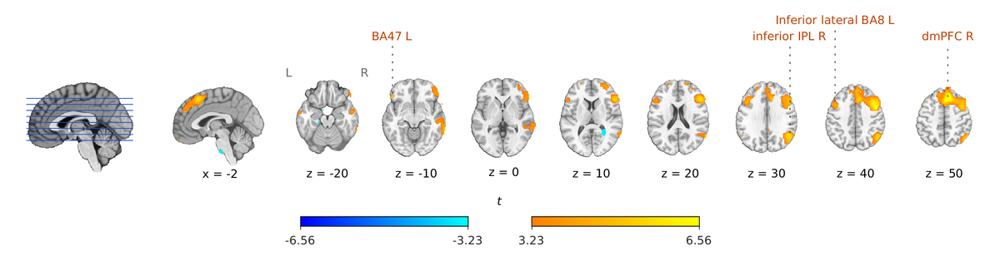

**Unthresholded map, pale, with FDR-significant voxels outlined** (section 4)

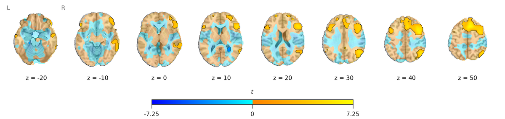

**Multi-threshold layers: p < .01 uncorrected under FDR q < .05** (section 5)

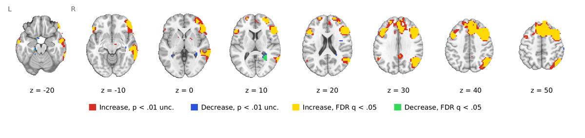

**Bayes factors: evidence for H1 (red) and H0 (blue), BF10 ≥ 3 / ≤ 1/3** (section 6)

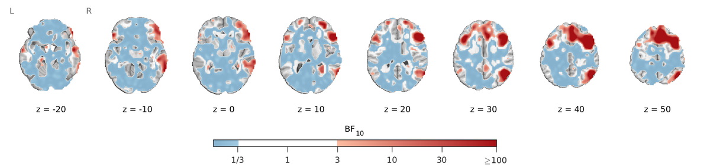

**fsLR inflated surfaces, projected from the volume** (section 7)

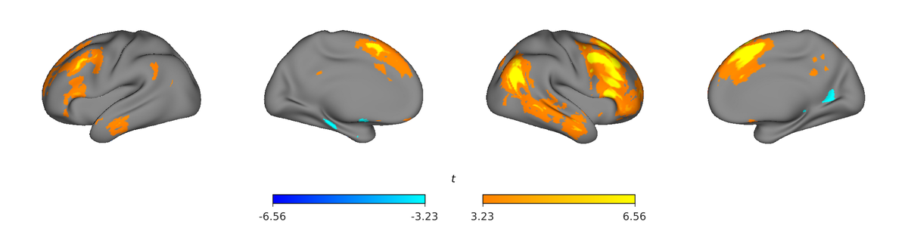

**Cutaway: left insula slab** (section 8)

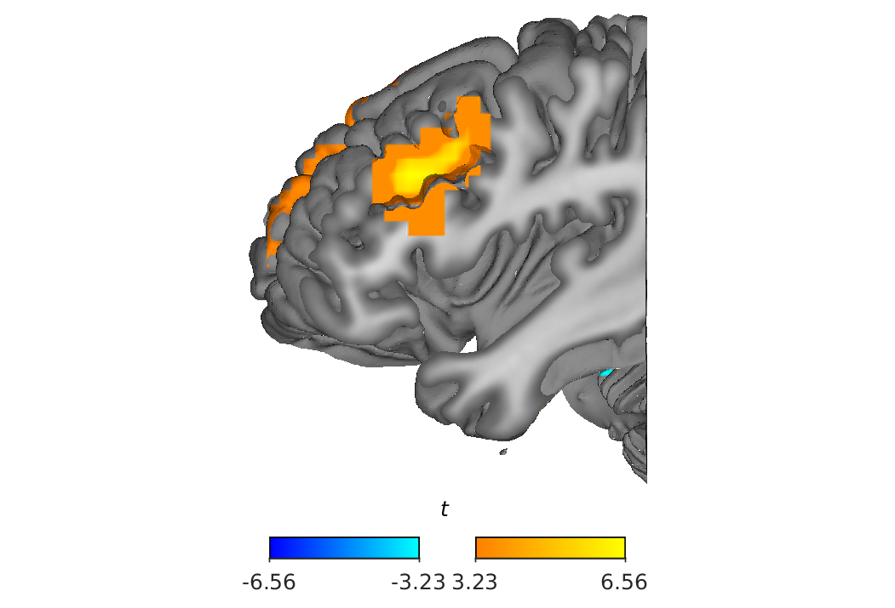

**Subcortical 3-D scene: thalamus, caudate, putamen, amygdala, brainstem** (section 9)

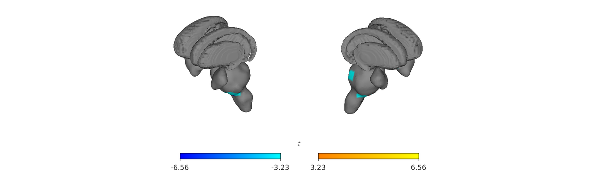

**One close-up per region (FDR, k ≥ 20), named at its peak voxel** (section 10)

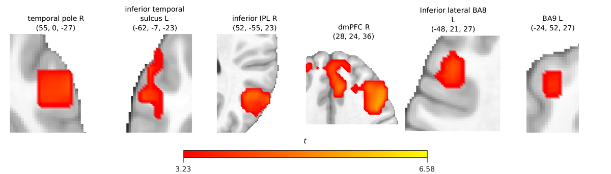

**Zoom insets on a sagittal slice** (section 11)

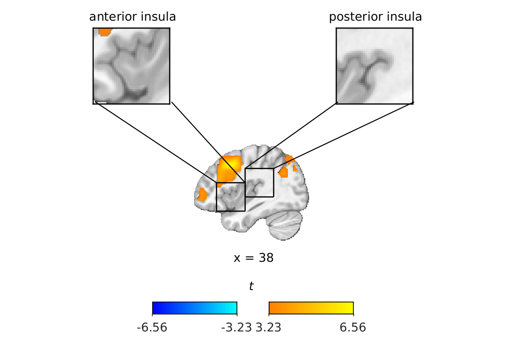

**Topography insets zooming out of the four strongest clusters** (section 11b)

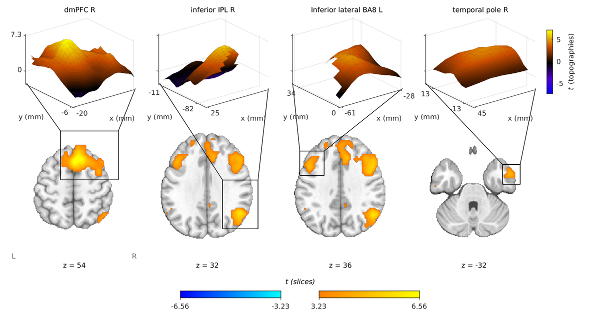

**Topography insets zooming out of atlas ROIs: ventral striatum and amygdala** (section 11c)

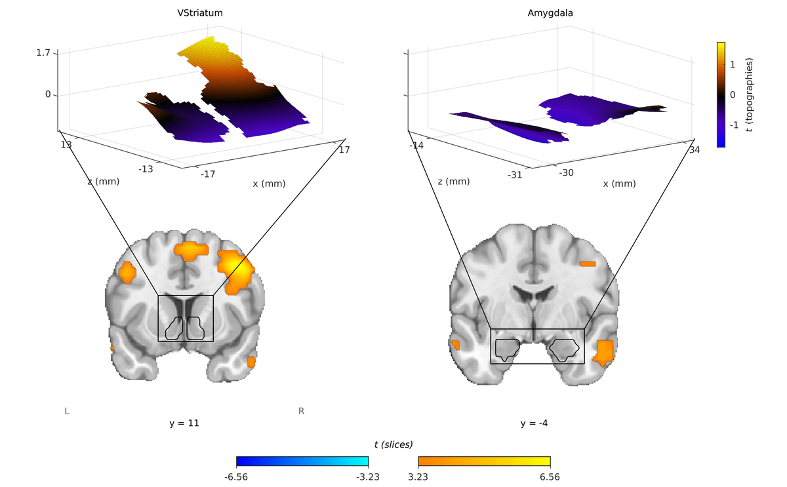

**Topography insets from the boxes of section 11** (section 11d)

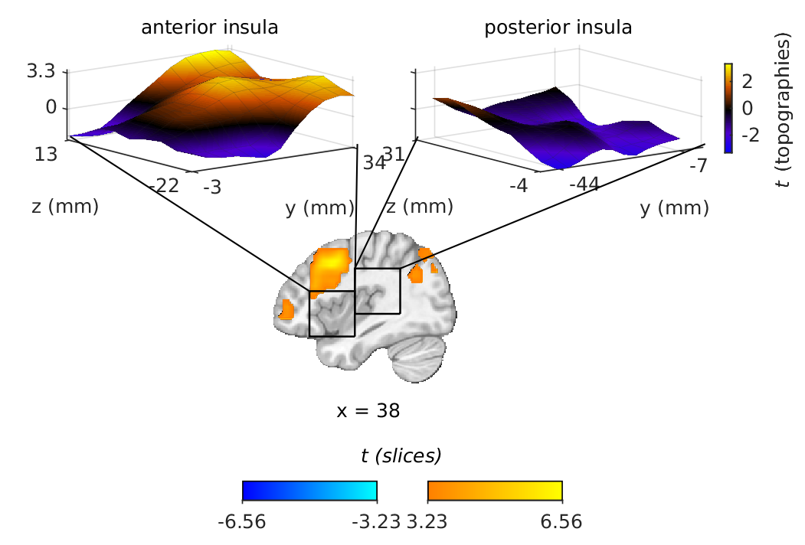

**An atlas subset (ventral striatum, amygdala, insula) coloured by its `labels_3` names, with a swatch legend** (section 12)


**The same subset as a mask, outlined over the FDR map** (section 13)

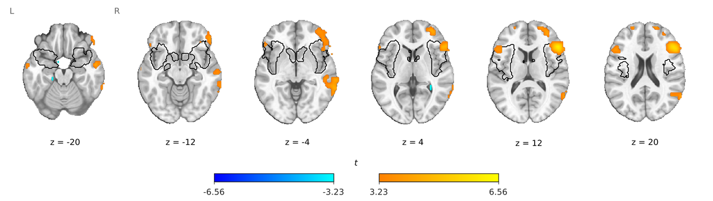

**Small multiples: nine participants, the same coordinate ringed on each** (section 14)

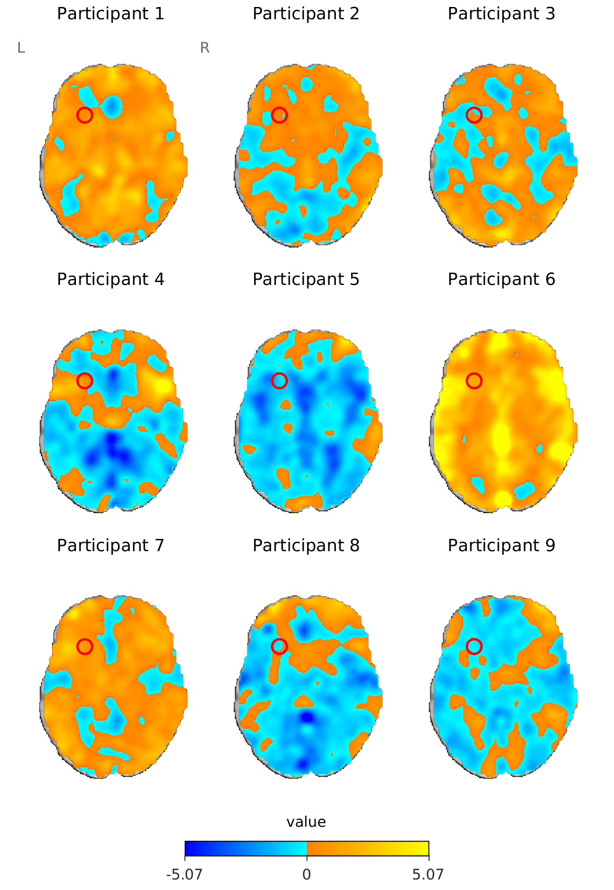

**Topography, `'roi'` mode: ventral striatum, hemispheres folded** (section 15)


**Topography, `'slice'` mode: one sagittal plane in a box** (section 15)


**Composite paper figure: slices, surfaces, subcortex and a topography** (section 16)

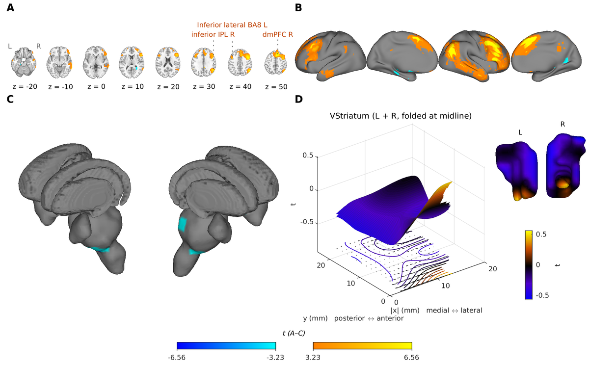

---

## Design decisions, measured

Each of these was checked on the LaBGAS server (MATLAB R2021a, CanlabCore of
2026-11) rather than assumed.

- **Surfaces are projected by default.** Volume-to-surface projection (MNIsurf,
  Wu et al. 2018) from `MNI152NLin2009cAsym` - fmriprep 20, i.e. LaBGAS data - to
  the fsLR_32k meshes. Rendered side by side on a bitter-reward t-map at
  p < .001, the unprojected default showed a handful of blobs where the projected
  rendering showed the cortical signal. For SPM-normalised data pass
  `'sourcespace', 'MNI152NLin6Asym'`.
- **fsLR surfaces and everything else are painted in separate `addblobs`
  calls.** `render_on_surface` switches projection off for the WHOLE call as soon
  as one surface lacks a left/right tag - which every cutaway and subcortical
  patch does.
- **Export uses `print`, not `exportgraphics`.** `exportgraphics` crops to the
  content: a 183 mm figure at 200 dpi came out 1362 x 242 px instead of
  1441 x 303. `print` with a fixed paper size gives the exact width a journal
  asks for.
- **Raster export through OpenGL where there is one.** CANlab slices are
  `surface` objects; `print` falls back to painters otherwise, 21 s against 12 s
  for one row of slices. Headless MATLAB has no OpenGL at all (`opengl('data')`
  reports `None`) and uses painters; `info.export_renderer` records which.
- **The display controller is switched off.** `fmridisplay` opens its
  interactive controller as a hidden uifigure for every object - suppressed by
  CanlabCore only under `-batch`, not `-nodisplay` - and they accumulated across
  calls. The function creates its object with `'nocontroller'` and closes the
  ones `canlab_results_fmridisplay` opens.
- **The underlay is read once per figure**, and handed back to each slice
  (`'volume_data'`), instead of once per slice.
- **Layers never overlap.** CanlabCore does not restack blobs, and a stricter
  threshold layer painted over a lenient one came out underneath it: in
  emotionreg, FDR q < .05 (2190 voxels) was almost invisible inside p < .01
  (3511). Each threshold level now shows only the voxels that do not also pass
  the next level, and the pale layer of `'unthresholded_outline'` leaves out
  the significant voxels, so draw order cannot matter.
- **Images are subset without `get_wh_image`.** On an `fmri_data_st`
  (`DATA_OBJ_CON` in the second-level templates) it returned all 21 images
  when asked for images 1:9. This affects any lab code that subsets participant
  images that way, not only this function. Use `'image', k` or, for small
  multiples, `'image', 1:9` on the whole object.
- **Preset layouts are cropped to what they draw.** CanlabCore's slice axes are
  taller than the figure (1.16 of its height for `compact2`) with each slice
  letterboxed inside, so the crop uses each axes' projected data box, not its
  Position.
- **Raster pdf / svg are built from the png.** `print`'s `'-image'` option does
  not exist in R2021a; the figure is printed to png at `'dpi'` and placed on a
  page of exactly the figure's size, which also works headless.
- **Default sagittal x = -2**, as in CanlabCore's `compact2`: x = 0 lies in the
  interhemispheric fissure, where the template has no occipital cortex.
- **Region names come from `labels_3` of `canlab2024_fine_fmriprep20_2mm`**
  (`'label_atlas'`, `'label_field'`). The fine atlas has one level more than the
  coarse one, so its levels are shifted by one: `labels` 570 parcel names
  (`Ctx_p32pr_L`, `BStem_LC_L`), `labels_2` 518, `labels_3` 246
  (`midcingulate_L`, `superior_premotor_L`), `labels_4` 83 regions
  (`cingulate_ACC_mPFC_L`, `Pons_L`) - specific enough to place a result,
  still readable in a figure; `labels_4` was too coarse. `labels_5` is not
  anatomy at all but the source atlas of each parcel (`Glasser2016 ...`).
- **Fonts**: Arial is not installed on the server; Helvetica and Liberation Sans
  (metric-compatible with Arial) are.

---

## Known limitations

- **Labels on 3-D views** use MATLAB's internal
  `matlab.graphics.chart.internal.convertDataSpaceCoordsToViewerCoords` to place a
  data point on the page. It is undocumented; if a MATLAB update removes it,
  labels on surfaces stop working before slices do.
- **Lit surfaces are always raster** in pdf / svg, whatever `'vector'` says.
- **Labels are de-overlapped on two lines, not optimised**: names never overlap,
  but leader lines can cross where neighbouring names had to move apart (a
  line passing a lower name goes behind it), and
  when a panel's band cannot hold them all a warning says so (in
  `info.warnings`). Lower `'max_labels'`, widen the figure, or pass labels
  explicitly.
- **The preset layouts** keep CanlabCore's own axes placement; only colours,
  size and export are this function's. Use `slices` / `composite` for control.
- Runs take tens of seconds per figure, most of it in rendering and `print`.
  **Unthresholded whole-brain layers are the slow case** - converting a
  whole-brain map to a region object for `addblobs` takes about a minute per
  map - so small multiples of unthresholded participant maps take minutes.
- **An atlas is drawn from its index image (`.dat`)**, and the legend lists only
  the parcels present there. If `.labels` names more parcels than `.dat` holds,
  this is reported in `info.warnings`: `model_3_food_images`'s merged
  `roi_atlas` in bitter-reward lists 2 labels with a single index.

---

## Testing

What was run, on the LaBGAS server (MATLAB R2021a), 2026-11-26/27:

- **The example script, headless**, start to finish, on the final code: all 19
  figure sections, 20 files (19 png + the composite's pdf) in 440 s, no figure
  left open and no warning from the function, with checksums confirming the code did
  not change during the run. Every output was inspected; the [Gallery](#gallery)
  is that run.
- **Options the example does not use**, headless on `emotionreg`: `'underlay',
  'mni152_1mm'` (slices and the `compact2` preset), `'clip_mask'` with
  `brain_mask_fmriprep20_template_1000.nii` (40 of 2190 FDR-significant voxels
  removed, 23 regions -> 22), zoom boxes given in reverse page order, and
  topography with `'hemisphere', 'left'` and with `'inset', false`, and the
  error for a `'zoom'` ROI name the atlas does not have.
- **Every layout on real bitter-reward second-level objects**, interactively,
  on 2026-11-26 - before the underlay, clip-mask, label-atlas, topography
  annotation and topography-inset changes of 2026-11-27, which were run on
  `emotionreg` only:
  `model_1_food_images` t-maps, Bayes-factor maps (2·ln BF, min BF10 = 0.23 at
  n = 21), SVM weight maps and the 21 participant contrast images, and
  `model_3_food_images`'s atlas and mask objects. These results come from the
  superseded first level and were used only to exercise the code.
- `checkcode` reports nothing on either file; `clean/use_before_def.py` passes on
  `figures/`. `clean/set_after_use.py` flags 30 names in the function file, all
  the same variable name reused in separate local functions, which a checker
  written for scripts reads as one namespace.

Not tested: the `vector` pdf/svg route headless, `'surface', 'flat'`, and the
`full hcp` / `full2` / `compact3` presets.
